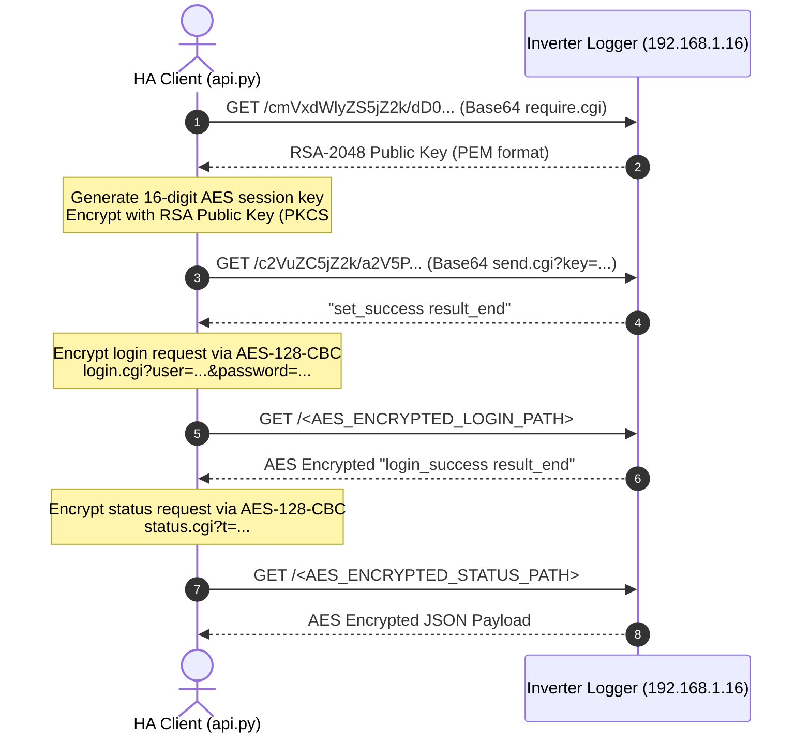

# Reverse Engineering the Microtek MTK GTI 3kW Solar Inverter (Deye OEM)

This document provides a comprehensive technical breakdown of how the data logger on the **Microtek MTK GTI 3kW D11** grid-tie solar inverter was reverse engineered, how data encryption and authentication function, and how it is polled locally by Home Assistant.

---

## 1. Hardware & System Identification

- **Inverter Model**: Microtek MTK GTI 3kW D11 (Single-Phase Grid-Tie Inverter)
- **OEM Hardware Manufacturer**: Deye / I-Grid OEM platform
- **Logger Firmware**: `DYDB_WiBLE_1.2.1` (WiFi + Bluetooth Low Energy data logger)
- **Default Cloud Platform**: `logger-india.deyecloud.com` / Solarman / Microtek Solar App
- **Local Network IP**: `192.168.1.X` (Station Mode DHCP)
- **Logger Web Interface Credentials**:
  - **Username**: `admin` (or user-configured admin name)
  - **Password**: `<YOUR_PASSWORD>` (configured during WiFi setup)

---

## 2. Protocol Investigation & Discovery

### A. The Modbus V5 (Port 8899) Attempt
Many Deye and Solarman loggers communicate via Modbus RTU-over-TCP using proprietary Solarman V5 frame headers (`0xA5 ... 0x15`) on UDP/TCP port `8899`.
- **Finding**: On this firmware (`DYDB_WiBLE_1.2.1`), port `8899` is closed / firewalled in Station Mode (`STA`). The logger strictly closes external raw sockets and only maintains an outbound tunnel to `logger-india.deyecloud.com:18899`.

### B. Discovering the Local Web Server (Port 80)
Port scanning revealed an open HTTP server on port 80:
```text
Port 80/tcp open  http  (Embedded HTTP/1.0 server)
```
Navigating to `http://192.168.1.16/` in the browser presents a web portal: `.::Welcome to the Web-Based Configurator::.` requiring authentication.

---

## 3. Reverse Engineering the Web Portal Encryption

By inspecting the client-side assets served by the web interface (`/cgi-bin/indexmain.cgi`), two key JavaScript files were identified:
- `rsa.js`: Implementation of RSA-2048 public key encryption.
- `aes.js`: Implementation of AES-128-CBC encryption with zero-padding.

### The Cryptographic Handshake Flow

The logger uses a hybrid encryption mechanism (RSA-2048 + AES-128-CBC) to protect web API requests and prevent unauthorized local scraping:



---

## 4. Encryption Implementation Details

### Step 1: RSA Public Key Retrieval (`require.cgi`)
- The client sends a Base64-encoded GET request:
  ```http
  GET /cmVxdWlyZS5jZ2k/dD0wLjEyMzQ1Njc4OTA= HTTP/1.0
  ```
- The logger responds with its 2048-bit RSA public key:
  ```text
  -----BEGIN PUBLIC KEY-----
  MIIBIjANBgkqhkiG9w0BAQEFAAOCAQ8AMIIBCgKCAQEAqzhyBCTXdPrJ0coIrazG
  ...
  twIDAQAB
  -----END PUBLIC KEY-----
  ```

### Step 2: AES Session Key Negotiation (`send.cgi`)
- The client generates a random 16-character numeric session key (e.g. `7492810384729104`).
- The session key is encrypted using the logger's RSA public key with `PKCS#1 v1.5` padding.
- The encrypted key is Base64-encoded and sent via `send.cgi?key=<base64_rsa_blob>`.
- The logger installs this session key into its active memory and replies:
  ```text
  set_success result_end
  ```

### Step 3: Zero-Padding AES-128-CBC Encryption
All subsequent URLs and parameters are encrypted using AES-128-CBC:
- **Key**: The 16-byte ASCII session key.
- **IV**: Equal to the 16-byte ASCII session key (`IV = Key`).
- **Padding Scheme**: Zero-byte padding (`\x00` padding up to multiple of 16 bytes), **NOT** PKCS#7.
- **URL Format**: The entire query string is encrypted and sent as the path:
  ```http
  GET /p3LhF...encrypted_base64_string... HTTP/1.0
  ```

### Step 4: Login Authentication (`login.cgi`)
- Plaintext payload:
  ```text
  login.cgi?user=admin&password=your_password&t=0.582910
  ```
- Encrypted using AES-128-CBC, then sent via HTTP GET.
- The decrypted response returns:
  ```text
  login_success result_end
  ```

### Step 5: Data Polling (`status.cgi`)
- Plaintext payload:
  ```text
  status.cgi?t=0.481920
  ```
- The logger returns an AES-128-CBC encrypted response terminating in `result_end`.
- When decrypted with the session key, it contains the JSON data block between `json_start` and `json_end`.

---

## 5. Inverter Data Payload Schema

The decrypted JSON response provides full telemetry from the inverter:

```json
{
  "inverter": {
    "sn": "2306012345",
    "mainVersion": "8351-0116",
    "info": [
      { "key": "ratedPower", "value": "3000 W" },
      { "key": "currentPower", "value": "802.0 W" },
      { "key": "yieldToday", "value": "9.50 kWh" },
      { "key": "totalYield", "value": "49.40 kWh" },
      { "key": "alerts", "value": "0" },
      { "key": "cloudConnected", "value": "1" },
      { "key": "faultAlert", "value": "0" }
    ]
  },
  "device": {
    "deviceSerialNum": "2306012345",
    "firmwareVersion": "DYDB_WiBLE_1.2.1",
    "sta": {
      "ip": "192.168.1.16",
      "signal": "4"
    }
  }
}
```

---

## 6. Critical Hardware Quirks & Solutions

| Quirk / Issue | Cause | Solution in `api.py` |
|---|---|---|
| **Connection Timeout / Lockup** | Embedded web server is `HTTP/1.0` and single-threaded. HTTP Keep-Alive leaves the socket half-open and freezes the chip. | Set `aiohttp.TCPConnector(force_close=True)` and send `Connection: close` header on every request. |
| **Token Expiry (`token_timeout`)** | Session key expires after prolonged inactivity or reboot. | Automatically catch `token_timeout` or `json_start not found`, renegotiate RSA/AES keys, and retry transparently. |
| **Zero Padding vs PKCS#7** | Standard Python `cryptography` defaults to PKCS#7, whereas the logger's firmware uses C-style `\x00` padding. | Custom `_zero_pad()` and `.rstrip("\x00")` functions implemented in `api.py`. |
